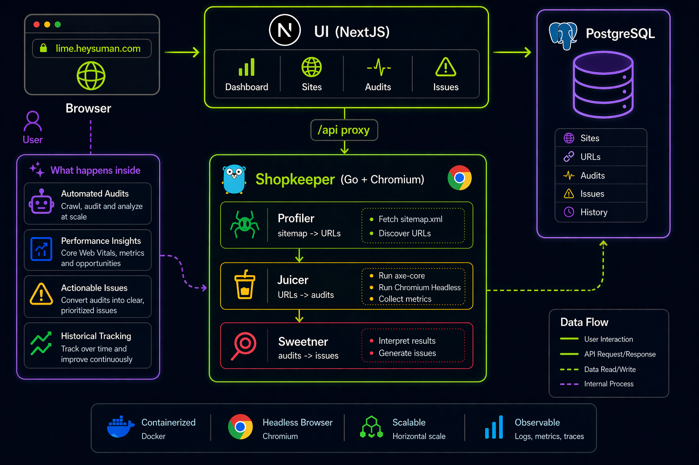

<div align="center">


# LIME

**Self-hosted accessibility scanner powered by axe-core.**
Scan sitemaps, capture screenshots, review issues in a dashboard.

[](https://github.com/sumanbasuli/lime/releases)
[](COPYING)
[](https://github.com/sumanbasuli/lime/pkgs/container/lime-shopkeeper)
[](https://github.com/sumanbasuli/lime/pkgs/container/lime-ui)

[Quick start](#quick-start) | [Deploy](#deploy) | [Docs](https://lime.heysuman.com/docs/) | [Roadmap](https://lime.heysuman.com/roadmap/) | [Releases](https://github.com/sumanbasuli/lime/releases)

</div>

---

## What is LIME?

LIME is an accessibility scanner you host yourself. Point it at a sitemap or a URL: it visits eligible pages with headless Chromium, runs configured WCAG A/AA axe-core checks with Lighthouse-aligned overrides, captures focused screenshots, and groups findings into reviewable issues with ACT rule guidance. Automated findings support review; they do not establish accessibility conformance on their own.

Migrations apply on boot, interrupted scans recover on restart, and deployment helpers support Docker and Debian systemd. Scan cost and report size depend on the target site and configured limits.

## Features

- **Full-site scans** driven by sitemap or sitemap-index, with viewport presets (desktop / laptop / tablet / mobile).
- **Per-issue screenshots** - highlighted visible capture + inline preview, spotlight overlay, focus/hover settle pass.
- **Axe-core + ACT** - Lighthouse-aligned rule set, ACT catalog bundled locally (no runtime W3C calls).
- **Reports** - PDF, CSV, and compact LLM-ready exports per scan or issue.
- **False-positive triage** flag per issue.
- **Partial scan retry** - retry failed pages inside the same scan without creating a second scan.
- **Pause and resume** - cooperatively pause an active scan and continue pending pages on the same scan.
- **Scan recovery** - non-terminal scans resume after Shopkeeper restarts.
- **Update notice** - enabled-by-default release checks and a sidebar banner when a newer GitHub release is available; server and browser controls let you opt out.
- **Full MCP workflows** - compatible AI clients read saved evidence, reports and screenshots, then manage scan/link lifecycles, false-positive triage, and reporting/performance settings with operator-enabled write access. Existing keys stay read-only by default.
- **Link checker** - bounded single-page or same-origin crawl checks with saved destinations/source references and CSV; opt in with **Include link check** on a normal accessibility scan without changing its score or screenshots. Six additive MCP tools read its saved history, totals, companion status, targets, and paginated references through the existing endpoint/key.
- **Deployment options** - Docker and Debian systemd.

## Architecture



- **[Shopkeeper](shopkeeper/)** - Go backend. Chi router, pgx, golang-migrate. Owns scan lifecycle, API routes, migrations, screenshots, PDFs, and the internal scan pipeline.
- **[UI](lime/)** - NextJS App Router, shadcn/ui, Drizzle ORM. Reads Postgres for server-rendered pages, owns settings and derived read caches, and proxies scan actions to Shopkeeper at runtime so the image stays generic.
- **Database** - PostgreSQL 17 shared by both services.

Shopkeeper pipeline:

| Stage | What it does |
|-------|--------------|
| **[Profiler](https://lime.heysuman.com/docs/reference/architecture/profiler/)** | Expands sitemap and sitemap-index inputs into a validated, deduplicated URL set for the scan. |
| **[Juicer](https://lime.heysuman.com/docs/reference/architecture/juicer/)** | Takes those URLs, drives Chromium workers, runs axe-core, captures screenshots, and records per-page audit outcomes. |
| **[Sweetner](https://lime.heysuman.com/docs/reference/architecture/sweetner/)** | Takes Juicer audit output and writes normalized issues, occurrences, audits, and review-required records. |

Full architecture docs: [lime.heysuman.com/docs/reference/architecture/shopkeeper](https://lime.heysuman.com/docs/reference/architecture/shopkeeper/).

## Quick start

Install Git, Make, and Docker with Compose, and start the Docker engine. From a new checkout:

```bash
git clone https://github.com/sumanbasuli/lime.git
cd lime
make init-env
make start-all
```

Open:

- **UI** - <http://localhost:3000>
- **API** - <http://localhost:8080/api/health>

`make stop-all` stops this project's stack and preserves its data. `make clean` deletes its database/screenshot volumes and local build artifacts; use it only for an intentional reset. Do not overwrite an existing `.env` when updating a checkout.

See [Setup](docs/setup.md) for prerequisites, native development, port overrides, and troubleshooting. Manual source and release Compose runs publish the dashboard and ordinary HTTP API on host interfaces by default. Neither has built-in user authentication: before making those ports reachable from another machine, restrict them with a firewall or authenticated reverse proxy and use TLS. The MCP bearer key protects MCP requests, not the rest of the dashboard.

## Deploy

LIME publishes versioned Docker images to GHCR from the main-branch release workflow. Choose the release you intend to deploy and replace `vX.Y.Z` below with its tag; it is a placeholder, not an instruction to install an older version.

| Target | One-liner | Guide |
|--------|-----------|-------|
| **Docker** | `docker compose -f docker-compose.release.yml up -d` | [Docker guide](https://lime.heysuman.com/docs/reference/deployment/docker/) |
| **Debian systemd** | `make debian-install` | [Debian guide](https://lime.heysuman.com/docs/reference/deployment/debian/) |

### Updating

Back up the database and screenshots before updating. Check your deployment guide for prerequisites, backup behavior, migration steps, and rollback limits.

```bash
make update-release TAG=vX.Y.Z            # published Docker images (repository helper)
sudo ./scripts/debian-update.sh vX.Y.Z    # Debian systemd
```

For a source-built Docker stack, preserve `.env` and volumes, take a matching backup, then use the maintenance-window `make update TAG=vX.Y.Z` command from the updated checkout. It rebuilds the Compose-selected images and checks backend/UI readiness; a live upgrade rehearsal and post-update scan/report check are still needed. Details and recovery: [update docs](https://lime.heysuman.com/docs/reference/deployment/updates/).

## Configuration

Runtime configuration lives in `.env` (root) or deploy-specific env files.

| Variable | Required | Description |
|----------|----------|-------------|
| `DATABASE_URL` | yes | PostgreSQL connection string, shared by UI and Shopkeeper. |
| `SHOPKEEPER_URL` | yes | Runtime backend URL for the UI's `/api/...` and `/mcp` proxies. |
| `LIME_IMAGE_REGISTRY` | release only | GHCR namespace for published images, e.g. `ghcr.io/sumanbasuli`. |
| `LIME_IMAGE_TAG` | release only | Pinned GHCR release tag selected for deployment. |
| `LIME_API_PORT` / `LIME_UI_PORT` | optional | Published ports (defaults 8080 / 3000). |
| `LIME_DB_BIND_HOST` | source Compose only | PostgreSQL host bind address; defaults to `127.0.0.1`. Expose it remotely only behind deliberate network controls. |
| `LIME_UPDATE_CHECK` | optional | Best-effort GitHub release checks are enabled by default. Set `false` to disable outbound checks; Settings also controls each browser's card visibility. |
| `LIME_GITHUB_REPO` | optional | Override the update-check repo (default `sumanbasuli/lime`). |
| `ACT_RULES_PATH` | optional | Override the bundled ACT catalog path. |

See the [setup docs](https://lime.heysuman.com/docs/reference/setup/) for the full table.

## Development

Use the Docker development stack for dashboard hot reload, or run the native services in separate terminals. Native development also needs Go, Node.js, installed dashboard dependencies, and Chromium; follow [Setup](docs/setup.md) rather than mixing the two workflows.

```bash
make start-dev           # full Docker stack with UI hot reload
make start-db            # native workflow: only Postgres
SHOPKEEPER_SCREENSHOT_DIR="$PWD/.artifacts/native-screenshots" make dev-shopkeeper
make dev-ui              # native workflow: NextJS with hot reload
```

| Command | Description |
|---------|-------------|
| `make start-all` | Production-style Docker stack built from source |
| `make start-dev` | Development Docker stack with NextJS hot reload |
| `make migrate-all` | Apply DB migrations |
| `make build` | Build Go + Next + release bundle into `dist/` |
| `make build-docker` | Build versioned Docker images locally |
| `make debian-install` | Build and install the native Debian systemd deployment |
| `make debian-update TAG=vX.Y.Z` | Update the native Debian systemd deployment |
| `make docs` | Refresh the static docs site with isolated heysuman.com demo screenshots |
| `make docs-run` | Build and serve the static docs site locally |
| `make docs-dev` | Run the docs site with NextJS hot reload |
| `make docs-verify` | Build and browser-check the marketing website and docs |
| `make verify-app` | Verify existing dashboard features against an isolated Docker stack and deterministic local pages |
| `make backup-db` | Dump the bundled Postgres to `dist/backups/` |
| `make update TAG=vX.Y.Z` | Maintenance update for a source-built Docker stack; back up screenshots/configuration separately |
| `make clean` | Stop the stack and delete its data volumes and local build artifacts |

## Tech stack

- **Backend**: Go 1.27, Chi, pgx, golang-migrate, chromedp
- **Frontend**: NextJS 16 (App Router), shadcn/ui, Drizzle ORM, TailwindCSS v4
- **Browser**: Chromium (Debian bookworm base image)
- **DB**: PostgreSQL 17

## Docs

Public docs are published at [lime.heysuman.com/docs](https://lime.heysuman.com/docs/). User workflow guides live in `docs-site/content/product-docs.ts`; repository reference Markdown lives in [docs/](docs/). [docs/index.md](docs/index.md) maps the reference guides, and [Docs Site](docs/docs-site.md) explains how both sources are published.

To review the complete marketing website and docs locally, install the docs dependencies with `npm --prefix docs-site ci`, then run `make docs-dev`. Open [http://localhost:3001](http://localhost:3001) for the website or [http://localhost:3001/docs/](http://localhost:3001/docs/) for documentation. `LIME_DOCS_PORT` overrides that port. The product dashboard runs separately at [http://localhost:3000](http://localhost:3000).

`make docs` refreshes the docs site locally. It uses a separate `lime-docs` Docker Compose project, separate Postgres and screenshot volumes, non-default ports, fresh single-page demo scans for `https://heysuman.com`, `https://www.fake-university.com/`, and `https://overlaysdontwork.com/`, and a new standalone link check for the selected capture target. It supplies explicit isolated IDs and refreshes ten product images, never current private/local scans. See [Docs Site](docs/docs-site.md) for capture arguments, wait boundaries, assertions, and cleanup.

For the project handoff, feature verification matrix, isolated test workflow, and current verification evidence, see [Verification And Handoff](docs/verification.md). The working **Link checker** replaces the earlier design preview in version 2.0: see the [user guide](https://lime.heysuman.com/docs/user/link-checker/) and [architecture/limits](docs/architecture/link-checker.md). Link reachability is separate from accessibility scoring and does not verify fragment anchors or JavaScript-created links.

## AI Client Integration

Use the dashboard's `http://localhost:3000/mcp` locally, or its reachable HTTPS `/mcp` URL remotely. Generate a key in **Settings > Integrations**, then configure a client supporting Streamable HTTP with a bearer header (or a reviewed local stdio bridge). The [MCP guide](docs/mcp.md) covers Codex, Claude Code, OpenCode, Cursor, VS Code, permissions, key rotation, troubleshooting, and SDK smoke checks. Canonical MCP exposes seventeen read tools and twenty-nine tools with operator-enabled writes. Read scans/issues/link sources, reports/screenshots and non-secret settings; opt into scan/link lifecycles, false-positive triage, and reporting/performance changes. MCP cannot change its own permissions or key. Existing keys remain read-only until the operator explicitly allows writes; deletion/settings confirmation and durable new-job request IDs are required. Ordinary dashboard/download routes do not inherit MCP authentication. Optional `LIME_MCP_LINK_CHECK_ID` selects saved evidence for the read-only operator smoke test; its `checked` output distinguishes actual reads from discovery. OAuth-only connectors are not supported, and localhost is not reachable from a cloud client.

Use the [LIME agent](agent/README.md) to review findings, check links, and manage scans from OpenClaw. It includes three skills and a setup guide, with read-only access by default. See the [agent reference](docs/agent.md) for configuration and maintenance.

## Contributing

Issues and pull requests welcome. Before opening a PR:

1. Run the focused checks for changed files and the integrated verification appropriate to the behavior; use `make build` for release or cross-stack changes.
2. Add new numbered migrations rather than editing applied migrations, and mirror schema changes in [`lime/src/db/schema.ts`](lime/src/db/schema.ts).
3. Update affected user guides, repository reference docs, and the API manifest alongside behavior changes.

See [CONTRIBUTING.md](CONTRIBUTING.md) for development setup, checks, and PR expectations.

## Release Checklist

Maintainers publish a release by updating [VERSION](VERSION), adding matching notes in [CHANGELOG.md](CHANGELOG.md), and merging to `main`. [release-docker.yml](.github/workflows/release-docker.yml) now runs `make build`, publishes the GHCR images through [`scripts/publish-release-images.sh`](scripts/publish-release-images.sh), and creates or updates the GitHub Release through [`scripts/publish-github-release.sh`](scripts/publish-github-release.sh). The release tag must be new; bump `VERSION` for every release.

## Support

Use [GitHub Issues](https://github.com/sumanbasuli/lime/issues) for bugs and deployment questions. Include the deploy target, release tag, relevant logs, and whether the scan was sitemap or single-page.

Security reports should follow [SECURITY.md](SECURITY.md).

## License

LIME is released under the [GNU General Public License v2.0](COPYING). See the `COPYING` file for the full text.
